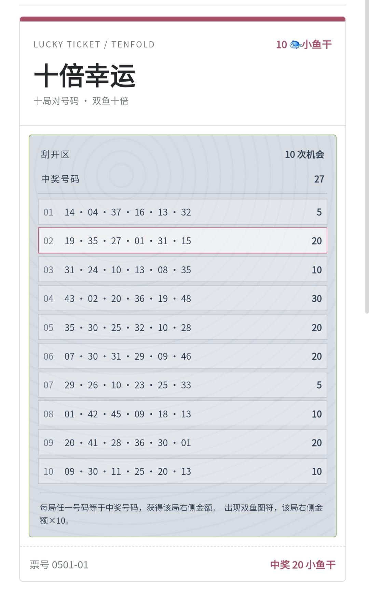
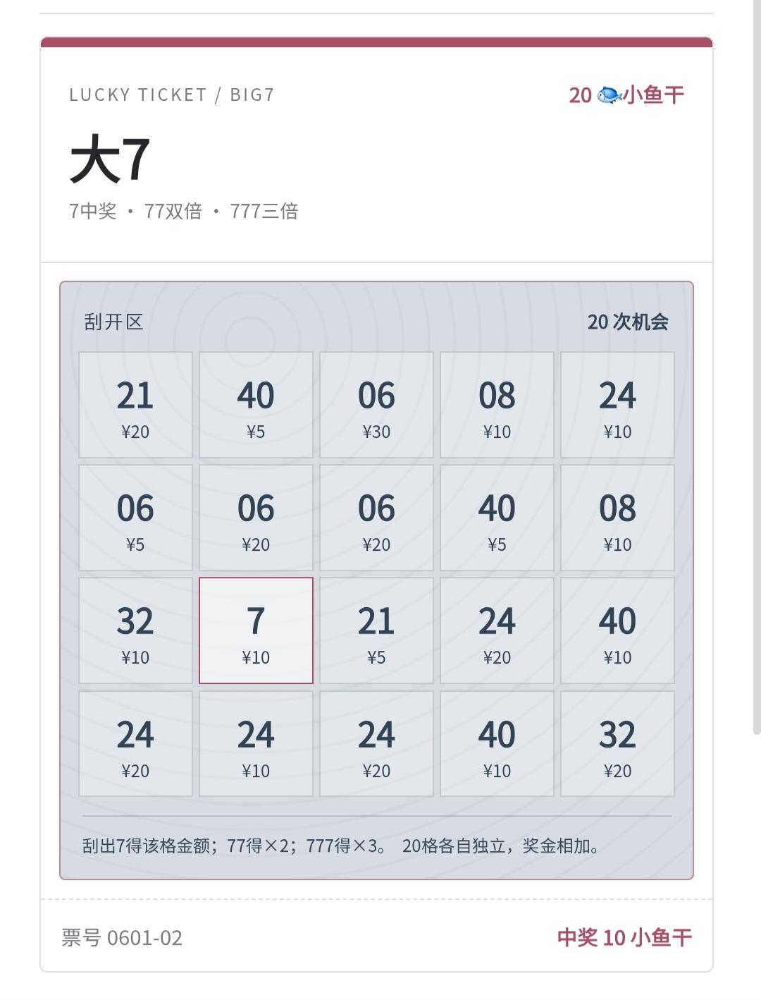

# luckyl

可嵌入聊天应用的**虚拟刮刮乐**模块：货架选票、刮开、票根、钱包扣款与兑奖。

> 使用宿主提供的**虚拟货币**，不连接真实彩票销售或兑奖。概率为项目内模拟设定，**不是**官方彩票概率。

## 票面预览

嵌入宿主后的真实票面效果（货币显示名由宿主的 `walletUnit()` 决定，下图为「小鱼干」）：

**十倍幸运** — 十局对号码 · 双鱼十倍



**大 7** — 7 中奖 · 77 双倍 · 777 三倍



其余四款（砸彩蛋、幸运日、中国红、喜相逢）同属这一套视觉：顶栏票种 / 价格、中部刮开区、底栏票号与结算。

## 接入宿主

加载：

1. `frontend/doodle/lottery.css`
2. `frontend/parts/27_lucky_ticket.js`

宿主需提供：

| 接口 | 作用 |
|------|------|
| `state` | 页面状态（模块使用 `subPage: "lottery"` 等） |
| `render()` | 刷新 UI |
| `ensureWallet()` | `{ balance }` |
| `walletUnit()` | 货币显示名（积分 / 金币 / 小鱼干…） |
| `walletEntry(n)` | 增减余额，不足时抛错 |
| `showToast?(msg)` | 可选 |
| `subHeader?()` | 可选顶栏 |
| `buildMainChatRequest` / `callOneAgentReply` | 可选，刮开旁白 |

全局对象：**`LuckyTicket`**。存储键默认 `luckyl-ticket-v1`。流水角色：`player` / `operator`。

票面文案里的「小鱼干」是占位符，展示时会替换成 `walletUnit()` 的返回值。

## 调爆率

编辑 `frontend/parts/27_lucky_ticket.js` 顶部 `PAYOUT`。保持 `jackpotRate + regularRate ≤ 1`。

## 自定义票面

> **TODO（欢迎 PR）** — 目前票种、配色、格数和判奖写在 `GAMES` / `LEGACY_GAMES` 与 `lottery.css` 里，改一款要动 JS + CSS。计划中的方向：

- [ ] 把单票的 **标题 / 副标题 / 主色 / 格布局 / 规则文案** 收成一份票面配置（JSON 或纯对象）
- [ ] CSS 用 CSS 变量（如 `--lt-ticket-accent`）按票种覆盖，减少硬编码
- [ ] 文档示例：从零加一款「只改配置、不改结算引擎」的新票
- [ ] 可选：更精致的刮开动效与未刮层材质（当前以清晰可读为先）

在此之前，自定义路径仍是：复制现有 `GAMES` 里一款 → 改 `id/name/price/rules` 与对应 CSS 类 → 跑 `node frontend/tests/lucky_ticket.test.cjs`。

## 测试

```sh
node frontend/tests/lucky_ticket.test.cjs
```

## 目录

- `frontend/parts/27_lucky_ticket.js` — 逻辑
- `frontend/doodle/lottery.css` — 样式
- `frontend/tests/lucky_ticket.test.cjs` — 规则与概率测试
- `docs/screenshots/` — 票面预览图

## 分享说明

适合作为**可嵌入模块**源码分享，不是独立上架的完整 App。公开时请保留「虚拟娱乐、非真实彩票」说明。
